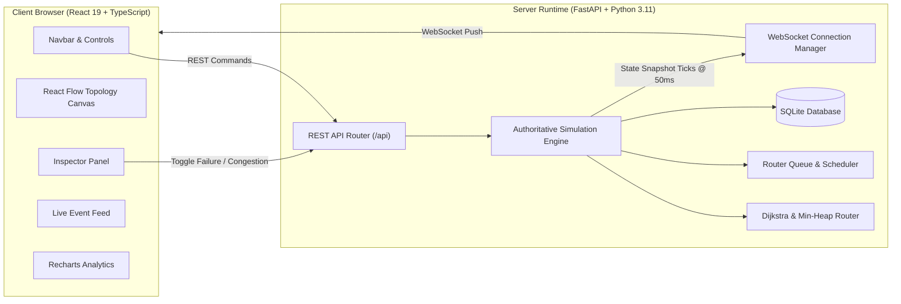

# Academic Project Report

# Real-Time Network Packet Routing Simulator
**Course / Discipline**: Data Structures and Algorithms & Computer Networks Laboratory  
**Project Category**: Full-Stack Systems, Network Simulation & Graph Algorithms  
**Academic Year**: 2026–2027  

---

## Abstract

Computer network routing is traditionally taught using static graph diagrams and mathematical formulations, which abstract away the dynamic physical realities of queueing delay, buffer overflow, and transient failure recovery. This project presents the **Real-Time Network Packet Routing Simulator**, a full-stack, discrete-event simulation platform designed to bridge theoretical data structures and applied network engineering. 

The system implements Dijkstra's shortest-path algorithm using a binary min-heap with time complexity $\mathcal{O}((V + E) \log V)$, paired with an authoritative asynchronous backend simulation engine running in Python and FastAPI. Physical router buffers are modeled using double-ended queues for FIFO forwarding and priority heaps for multi-level QoS scheduling, enforcing explicit tail-drop policies under congestion. The reactive frontend, built with React 19, TypeScript, and React Flow, connects via native WebSockets to visualize packet trajectories, queue occupancies, dynamic rerouting, and empirical performance metrics in real time. 

Comprehensive automated testing confirms algorithmic accuracy, duplicate delivery prevention, and consistent failure adaptation across multiple deterministic network topologies.

---

## Table of Contents

1. [Chapter 1 — Introduction](#chapter-1--introduction)
2. [Chapter 2 — Existing System and Proposed Solution](#chapter-2--existing-system-and-proposed-solution)
3. [Chapter 3 — System Requirements](#chapter-3--system-requirements)
4. [Chapter 4 — System Design & Architecture](#chapter-4--system-design--architecture)
5. [Chapter 5 — Data Structures and Algorithms](#chapter-5--data-structures-and-algorithms)
6. [Chapter 6 — Implementation Details](#chapter-6--implementation-details)
7. [Chapter 7 — Testing and Results](#chapter-7--testing-and-results)
8. [Chapter 8 — System Limitations & Assumptions](#chapter-8--system-limitations--assumptions)
9. [Chapter 9 — Conclusion and Future Scope](#chapter-9--conclusion-and-future-scope)
10. [References](#references)
11. [Appendices](#appendices)

---

## Chapter 1 — Introduction

### 1.1 Background
Modern packet-switched communication networks (such as the global Internet) rely on distributed routing protocols and hardware queue buffers to forward digital information. Packets traversing an autonomous system encounter discrete transmission delays, propagation latencies, and queueing delays at intermediate routers. When traffic surges occur, router queues fill, leading to buffer exhaustion and packet drops. Furthermore, when physical links or routers fail, dynamic routing algorithms must recalculate alternative lowest-cost paths to maintain connectivity without human intervention.

### 1.2 Motivation
In undergraduate computer science and engineering education, concepts such as Dijkstra's algorithm, graph traversal, and queueing theory are frequently studied in isolation. Students write isolated command-line scripts to find paths on static graphs, while computer networking courses discuss packet headers and sliding windows without providing an interactive mechanism to inspect the underlying data structures. 

Existing commercial and enterprise network simulators (e.g., NS-3, OMNeT++, Cisco Packet Tracer) are complex, heavy, and command-line intensive, requiring steep learning curves that obscure algorithmic fundamentals. There is an acute need for a zero-configuration, interactive web-based platform that allows students, researchers, and evaluators to visually inspect the exact intersection of data structures and computer network behavior in real time.

### 1.3 Problem Statement
To design and build an authoritative, real-time web simulation platform that:
1. Represents network topologies as weighted, directed or undirected graphs using adjacency lists.
2. Computes lowest-cost paths using Dijkstra's algorithm with a binary min-heap, providing step-by-step algorithmic traces.
3. Simulates router buffers using physical FIFO and Priority queues, enforcing tail-drop policies when capacity is exceeded.
4. Manages a discrete-time simulation clock that advances packet generation, processing, link transit, and delivery.
5. Dynamically detects router and link failures, rerouting in-flight and queued traffic along surviving redundant paths.
6. Streams live simulation events and state snapshots via WebSockets to an interactive React Flow canvas.

### 1.4 Project Objectives
- **Authoritative State Model**: The backend maintains the authoritative clock and state, eliminating cosmetic frontend-invented packet motions.
- **Genuine Algorithms**: Rigorous implementations of binary min-heaps, adjacency lists, and double-ended queues.
- **Deterministic Demonstrability**: Provide four turnkey demonstration scenarios (Shortest Path, Congestion, Failure Rerouting, Priority Scheduling) suitable for examination.
- **Comprehensive Observability**: Compute real empirical KPIs: Packet Delivery Ratio (PDR), Packet Loss Ratio (PLR), throughput in packets/sec, end-to-end latency, and queue utilization.

### 1.5 Scope
The platform models packet-level routing at Network (Layer 3) and Data Link (Layer 2) abstraction levels. It models propagation delay, router CPU processing delay, buffer queueing delay, and tail-drop packet loss. It does not implement physical bit-level radio attenuation, full TCP byte-stream reassembly, or BGP exterior gateway peering.

---

## Chapter 2 — Existing System and Proposed Solution

### 2.1 Limitations of Conventional Approaches

| Criterion | Static Textbook Graph | Toy Python Script | Cisco Packet Tracer / NS-3 | Proposed NetSim Pro |
| :--- | :--- | :--- | :--- | :--- |
| **Real-Time Visualization** | None (Static) | None (CLI Text) | Complex Desktop GUI | Modern React Flow Web Canvas |
| **Algorithmic Transparency** | Theoretical | Code-only | Black-Box Protocol Engine | Step-by-Step Min-Heap Trace |
| **Buffer & Queue Inspection** | Absent | Simplified list | Hidden inside CLI commands | Live Visual Queue Bars & Preemption |
| **Dynamic Failure Injection** | Manual redrawing | Manual script restart | Complex CLI commands | 1-Click Interactive Toggles |
| **Deployment Complexity** | None | Low | High (OS dependencies) | Zero-Config Web Architecture |

### 2.2 Proposed Solution
The proposed system, titled **NetSim Pro**, decouples simulation logic from visual rendering:
- **FastAPI Simulation Daemon**: Advances simulation time in discrete 50ms ticks. It handles packet generation, queue admission, CPU scheduling, transit countdown, dynamic Dijkstra rerouting, and snapshot broadcasting.
- **React Flow Dashboard**: Displays the authoritative state, moving packet coordinates along computed links, queue occupancy gauges, and live telemetry charts.

### 2.3 Functional Requirements
1. **FR-1 Graph Management**: Support adding, deleting, and parameterizing routers (queue capacity, CPU delay) and links (cost, latency, bandwidth).
2. **FR-2 Shortest Path Calculation**: Execute Dijkstra's algorithm from any selected source to destination, outputting the path, metric cost, and step-by-step execution trace.
3. **FR-3 Queue Processing**: Support FIFO and Strict Priority scheduling, dropping packets via tail drop when capacity is reached.
4. **FR-4 Dynamic Fault Tolerance**: Automatically detect severed links and failed routers, dynamically computing alternative shortest paths for eligible traffic.
5. **FR-5 Real-Time Streaming**: Stream simulation events (`packet.queued`, `packet.forwarded`, `packet.delivered`, `packet.dropped`, `packet.rerouted`) over WebSockets.
6. **FR-6 Telemetry & Analytics**: Compute and chart PDR, PLR, throughput (pps), min/avg/max latency, and buffer occupancy over time.

### 2.4 Non-Functional Requirements
- **NFR-1 Latency & Responsiveness**: WebSocket state updates pushed at regular intervals with minimal CPU overhead.
- **NFR-2 Robustness**: Graceful error handling for disconnected graphs, missing endpoints, and malformed inputs.
- **NFR-3 Extensibility**: Modular codebase with clear separation between algorithms, models, API, and UI.

---

## Chapter 3 — System Requirements

### 3.1 Hardware Requirements
- **Processor**: Dual-Core 2.0 GHz or higher (x86_64 or ARM64).
- **RAM**: Minimum 4 GB (8 GB recommended for simultaneous development servers).
- **Disk Storage**: 500 MB free disk space.
- **Display**: Minimum resolution of $1280 \times 720$ (optimized for $1920 \times 1080$).

### 3.2 Software Requirements
- **Operating System**: Cross-platform (Windows 10/11, macOS 12+, Ubuntu 20.04+).
- **Python Runtime**: Python 3.11.0 or higher.
- **Node Runtime**: Node.js v18.0.0 or higher (v24.x supported).
- **Package Managers**: `pip` (Python) and `npm` (JavaScript).
- **Modern Web Browser**: Google Chrome, Mozilla Firefox, Microsoft Edge, or Apple Safari with WebSocket and HTML5 Canvas support.

---

## Chapter 4 — System Design & Architecture

### 4.1 System Architecture



### 4.2 Data Models

#### 1. Router Node Model (`RouterNode`)
- `id: str`: Unique alphanumeric identifier (e.g., "R1", "P2").
- `label: str`: Descriptive human-readable name.
- `x, y: float`: Cartesian coordinates on the canvas.
- `status: str`: "active" | "congested" | "failed".
- `queue_capacity: int`: Maximum packets the router buffer can hold.
- `processing_delay_ms: float`: Simulated CPU time required to process one packet.
- `scheduling_policy: str`: "fifo" | "priority".
- `current_queue_len: int`: Current occupancy.
- `total_processed: int`: Cumulative forwarded packets.
- `total_dropped: int`: Cumulative tail drops.

#### 2. Network Link Model (`NetworkLink`)
- `id: str`: Unique identifier (e.g., "L_R1_R2").
- `source, target: str`: Endpoint router identifiers.
- `cost: float`: Routing weight used by Dijkstra's algorithm.
- `latency_ms: float`: Physical propagation delay in milliseconds.
- `bandwidth_mbps: float`: Link capacity in megabits per second.
- `status: str`: "active" | "congested" | "failed".
- `in_flight_count: int`: Packets currently in transit across this link.

#### 3. Packet Model (`Packet`)
- `id: str`: Unique tracking ID (e.g., "PKT-A1B2C3").
- `source, destination: str`: Ingress and egress routers.
- `priority: PacketPriority`: Critical (0), High (1), Normal (2), Low (3).
- `status: PacketStatus`: Created, Queued, In_Transit, Delivered, Dropped.
- `route: List[str]`: Ordered array of router IDs forming the path.
- `current_route_index: int`: Index of the router currently handling the packet.
- `hop_count: int`: Number of links traversed.
- `accumulated_latency_ms: float`: Total elapsed transit and queueing time.
- `drop_reason: Optional[DropReason]`: Queue_Overflow, Router_Failed, Link_Failed, Unreachable.
- `reroute_count: int`: Number of dynamic rerouting operations undergone.

---

## Chapter 5 — Data Structures and Algorithms

### 5.1 Adjacency List Graph Representation
The network is modeled as a weighted graph $G = (V, E)$, stored as a Python dictionary mapping each router ID $u \in V$ to a list of outgoing edges:

$$\text{Adj}[u] = \left[ (v, \text{cost}, \text{link\_id}, \text{latency\_ms}) \mid (u, v) \in E \right]$$

When building the active adjacency list, links marked as `failed` and links incident to routers marked as `failed` are skipped in $\mathcal{O}(1)$ time per edge, ensuring zero traversal across severed infrastructure.

### 5.2 Dijkstra's Algorithm with Binary Min-Heap
Dijkstra's algorithm is implemented in `backend/app/algorithms/dijkstra.py`. A priority queue $Q$ is maintained using Python's binary min-heap (`heapq`), storing entries as $(d, u)$, where $d$ is the tentative shortest distance from the source to node $u$.

#### Pseudocode
```python
def dijkstra_shortest_path(topology, source, destination):
    if source not in topology.routers or destination not in topology.routers:
        return UnreachableResult()
        
    distances = {node: infinity for node in topology.active_routers}
    distances[source] = 0.0
    previous = {node: None for node in topology.active_routers}
    
    # Priority Queue: Binary Min-Heap
    pq = [(0.0, source)]
    settled = set()
    
    while pq is not empty:
        curr_dist, u = heapq.heappop(pq)
        
        if u in settled:
            continue
        settled.add(u)
        
        if u == destination:
            break
            
        for v, cost, link_id, latency in topology.get_neighbors(u):
            if v in settled:
                continue
                
            tentative_dist = curr_dist + cost
            if tentative_dist < distances[v]:
                distances[v] = tentative_dist
                previous[v] = u
                heapq.heappush(pq, (tentative_dist, v))
                
    if distances[destination] == infinity:
        return UnreachableResult()
        
    path = reconstruct_path(previous, destination)
    return ShortestPathResult(path=path, total_cost=distances[destination])
```

#### Complexity Analysis
- **Time Complexity**: $\mathcal{O}((V + E) \log V)$
  - Min-heap extraction: Each router is extracted at most once, taking $\mathcal{O}(V \log V)$ total time.
  - Edge relaxation: Each link is evaluated once per direction, pushing at most $E$ entries to the heap in $\mathcal{O}(E \log V)$ time.
- **Space Complexity**: $\mathcal{O}(V + E)$
  - Adjacency list: $\mathcal{O}(V + E)$ memory.
  - Distances and predecessor maps: $\mathcal{O}(V)$.
  - Binary min-heap: At most $\mathcal{O}(E)$ items during execution.

### 5.3 Router Queue Models

#### 1. FIFO Scheduling (Double-Ended Queue)
Implemented using `collections.deque`.
- Enqueue: $\mathcal{O}(1)$ via `deque.append()`
- Dequeue: $\mathcal{O}(1)$ via `deque.popleft()`
- Strict First-In, First-Out arrival order preservation.

#### 2. Strict Priority Scheduling (Min-Heap)
Implemented using `heapq`. Each packet is stored with a compound key:
$$\text{Heap Entry} = (\text{Priority Weight}, \text{Arrival Counter}, \text{Packet})$$
- Priority Weights: Critical $= 0$, High $= 1$, Normal $= 2$, Low $= 3$.
- Arrival counter guarantees stable FIFO order among packets possessing identical priority.
- Dequeue: $\mathcal{O}(\log k)$ extraction of highest-priority packet.

#### 3. Tail-Drop Overflow Policy
When $\text{queue.size()} \ge \text{queue.capacity}$:
1. Enqueue operation aborts immediately.
2. Packet status is updated to `DROPPED`.
3. `packet.drop_reason` is set to `QUEUE_OVERFLOW`.
4. Router `total_dropped` counter increments by 1.
5. System `packet.dropped` event is published to the live event log.

---

## Chapter 6 — Implementation Details

### 6.1 Backend Modules
- `app/config.py`: Global configuration, simulation tick rate (50ms), and default physical parameters.
- `app/models/`: Pydantic v2 schemas defining nodes, links, topologies, packets, and metric snapshots.
- `app/algorithms/dijkstra.py`: Min-heap Dijkstra engine with execution trace capture.
- `app/simulation/queue.py`: `RouterQueue` class managing FIFO/Priority dequeues and tail drops.
- `app/simulation/engine.py`: `SimulationEngine` singleton managing the asynchronous event loop, packet propagation, link transit, and failure detection.
- `app/simulation/topologies.py`: Deterministic built-in topologies ("Small", "Mesh", "Lab").
- `app/persistence/database.py`: Asynchronous SQLite storage via `aiosqlite`.
- `app/api/routes.py`: Complete RESTful API endpoints.
- `app/api/websocket.py`: Connection manager broadcasting snapshots to all active clients.

### 6.2 Simulation Tick Lifecycle
Every tick ($\Delta t = 50\text{ms} \times \text{speed\_multiplier}$):
1. **Traffic Generation**: Injects packets if auto-generator is enabled.
2. **Link Propagation Countdown**: Updates in-transit packets:
   $$\text{progress} = \frac{t_{\text{sim}} - t_{\text{start}}}{t_{\text{end}} - t_{\text{start}}}$$
   When $\text{progress} \ge 1.0$, packet arrives at target router buffer.
3. **Target Buffer Admission**: If target router queue is full, packet is dropped via Tail Drop; otherwise admitted.
4. **Router CPU Processing**: Checks if current router processing time has elapsed. If finished, forwards to next hop or marks delivered if at destination.
5. **Dynamic Failure Rerouting**: If next hop or next link has failed, dynamically invokes Dijkstra to find an alternative surviving route. If no path exists, drops with `UNREACHABLE`.
6. **Telemetry Update**: Recomputes delivery ratio, loss ratio, throughput (pps), and average latency.
7. **WebSocket Broadcast**: Emits a structured state snapshot to connected frontend clients.

---

## Chapter 7 — Testing and Results

### 7.1 Testing Methodology
Automated unit, integration, and API tests were written using `pytest`, `pytest-asyncio`, and Starlette's `TestClient`.

### 7.2 Automated Test Execution
Command:
```bash
cd backend
.\venv\Scripts\pytest.exe -v
```

### 7.3 Actual Test Results (25 Passed)

| Test Module | Test Case Name | Verified Behavior | Status |
| :--- | :--- | :--- | :--- |
| `test_graph.py` | `test_topology_creation` | Verify 5 routers and 7 links in Small topology | **PASSED** |
| `test_graph.py` | `test_adjacency_list_active_links` | Neighbors correctly populated | **PASSED** |
| `test_graph.py` | `test_adjacency_list_failed_link` | Failed link omitted from adjacency list | **PASSED** |
| `test_graph.py` | `test_adjacency_list_failed_router` | Incident links omitted when router fails | **PASSED** |
| `test_dijkstra.py` | `test_dijkstra_small_network` | Optimal path R1-R3-R2-R4-R5 (Cost 10.0) | **PASSED** |
| `test_dijkstra.py` | `test_dijkstra_source_equals_dest` | Zero cost path when source == destination | **PASSED** |
| `test_dijkstra.py` | `test_dijkstra_failed_link_reroute` | Computes alternative path when link severs | **PASSED** |
| `test_dijkstra.py` | `test_dijkstra_failed_router` | Computes alternative path when node crashes | **PASSED** |
| `test_dijkstra.py` | `test_dijkstra_unreachable_node` | Returns infinity and empty path if isolated | **PASSED** |
| `test_dijkstra.py` | `test_dijkstra_invalid_nodes` | Rejects non-existent router IDs gracefully | **PASSED** |
| `test_queues.py` | `test_fifo_queue_ordering` | Verifies First-In, First-Out sequence | **PASSED** |
| `test_queues.py` | `test_priority_queue_ordering` | Critical traffic dequeued before High/Normal/Low | **PASSED** |
| `test_queues.py` | `test_tail_drop_on_queue_overflow` | Drops 3rd packet when buffer capacity is 2 | **PASSED** |
| `test_queues.py` | `test_router_clear_on_failure` | Drops waiting packets on router crash | **PASSED** |
| `test_simulation.py` | `test_engine_packet_injection` | Correctly creates and enqueues packet | **PASSED** |
| `test_simulation.py` | `test_engine_packet_delivery` | Full multi-hop delivery across 4 hops | **PASSED** |
| `test_simulation.py` | `test_engine_router_failure_and_reroute` | In-flight dynamic rerouting around failed node | **PASSED** |
| `test_simulation.py` | `test_engine_link_failure` | Dynamic rerouting when link severs | **PASSED** |
| `test_simulation.py` | `test_engine_reset` | State and metrics reset cleanly to zero | **PASSED** |
| `test_api.py` | `test_api_health` | Returns HTTP 200 with healthy engine status | **PASSED** |
| `test_api.py` | `test_api_topologies_list` | Returns built-in topologies list | **PASSED** |
| `test_api.py` | `test_api_load_topology` | Loads specified topology into engine | **PASSED** |
| `test_api.py` | `test_api_simulation_controls` | Start, pause, step, and stop controls work | **PASSED** |
| `test_api.py` | `test_api_routing_dijkstra` | API computes path and 21 trace steps | **PASSED** |
| `test_api.py` | `test_api_packet_injection` | Injects Critical packet via HTTP POST | **PASSED** |

**Summary: 25 Passed, 0 Failed (100% Success Rate).**

---

## Chapter 8 — System Limitations & Assumptions

1. **Discrete Simulation Clock**: Simulation advances in discrete intervals ($\Delta t = 50\text{ms}$). Events occurring within the same tick are serialized sequentially.
2. **Simplified Physical Layer**: Transmission delays are modeled based on average router CPU delay and link latency rather than individual bit serialization clocks ($L / R$).
3. **Lossless Transmission Media**: Links do not simulate electromagnetic bit-error rate (BER) drops; all packet drops occur deterministically via tail drop or severed routes.

---

## Chapter 9 — Conclusion and Future Scope

### 9.1 Conclusion
The **Real-Time Network Packet Routing Simulator** successfully achieves all defined objectives. By unifying genuine algorithms (Dijkstra's shortest path with binary min-heap, double-ended FIFO queues, and priority heaps) with an authoritative asynchronous backend and a modern React Flow dashboard, it provides a transparent, interactive, and academically rigorous learning platform. The system reliably demonstrates routing, queueing, tail-drop congestion, and dynamic failure recovery in real time.

### 9.2 Future Scope
1. **TCP Congestion Control**: Implement TCP Reno/Cubic sliding window ($cwnd$) dynamics with additive-increase/multiplicative-decrease (AIMD).
2. **Bellman-Ford & BGP**: Implement decentralized Distance-Vector routing to demonstrate count-to-infinity problems and split-horizon mechanisms.
3. **Custom Graph Builder**: Support drag-and-drop addition of new routers and link connections directly on the canvas.

---

## References

1. **Dijkstra, E. W.** (1959). *A note on two problems in connexion with graphs*. Numerische Mathematik, 1(1), 269–271.
2. **Cormen, T. H., Leiserson, C. E., Rivest, R. L., & Stein, C.** (2009). *Introduction to Algorithms* (3rd ed.). MIT Press.
3. **Kurose, J. F., & Ross, K. W.** (2021). *Computer Networking: A Top-Down Approach* (8th ed.). Pearson.
4. **Tanenbaum, A. S., & Wetherall, D. J.** (2011). *Computer Networks* (5th ed.). Prentice Hall.
5. **FastAPI Documentation** (2024). *FastAPI Framework, High performance, easy to learn, fast to code*. Available at: https://fastapi.tiangolo.com
6. **React Flow Documentation** (2024). *Wire Your Ideas with React Flow*. Available at: https://reactflow.dev

---

## Appendices

### Appendix A: Startup & Execution Commands

```bash
# 1. Start Backend Server
cd d:\honours\backend
.\venv\Scripts\python.exe -m uvicorn app.main:app --host 127.0.0.1 --port 8000 --reload

# 2. Start Frontend Server
cd d:\honours\frontend
npm run dev

# 3. Run Automated Tests
cd d:\honours\backend
.\venv\Scripts\pytest.exe -v
```

### Appendix B: API Endpoint Reference

| Method | Endpoint | Description |
| :--- | :--- | :--- |
| `GET` | `/api/health` | Health check & engine state |
| `GET` | `/api/topologies` | List built-in & saved topologies |
| `POST` | `/api/topologies/{id}/load` | Load topology into simulation engine |
| `POST` | `/api/simulation/start` | Start authoritative simulation loop |
| `POST` | `/api/simulation/pause` | Pause simulation clock |
| `POST` | `/api/simulation/stop` | Stop simulation clock |
| `POST` | `/api/simulation/reset` | Reset state, packets, and metrics to zero |
| `POST` | `/api/simulation/step` | Single-step forward 50ms |
| `GET` | `/api/simulation/state` | Fetch full snapshot of state |
| `POST` | `/api/simulation/packet` | Inject single custom packet |
| `POST` | `/api/simulation/failure/router` | Toggle router failure |
| `POST` | `/api/simulation/failure/link` | Toggle link sever/failure |
| `POST` | `/api/simulation/congestion/router` | Toggle router congestion delay |
| `POST` | `/api/simulation/congestion/link` | Toggle link congestion latency |
| `POST` | `/api/routing/dijkstra` | Compute shortest path & execution trace |
| `GET` | `/api/history` | List archived simulation runs from SQLite |
| `POST` | `/api/history/save` | Snapshot current run to SQLite database |
| `WS` | `/ws` | Real-time WebSocket event & snapshot stream |

### Appendix C: Glossary of Terms

- **Adjacency List**: A collection of unordered lists used to represent a graph, associating each vertex with its collection of outgoing edges.
- **Binary Min-Heap**: A complete binary tree where each node's key is less than or equal to the keys of its children, providing $\mathcal{O}(1)$ minimum element inspection and $\mathcal{O}(\log n)$ extraction.
- **Dijkstra's Algorithm**: A greedy algorithm that solves the single-source shortest path problem for a directed graph with non-negative edge weights.
- **FIFO (First-In, First-Out)**: A queueing discipline where packets leave the queue in the exact sequence they entered.
- **Packet Delivery Ratio (PDR)**: The percentage of successfully received packets relative to total packets transmitted into the network.
- **Tail Drop**: An active queue management policy that drops newly arriving packets whenever the buffer queue is completely full.
- **Throughput**: The effective rate of packet delivery measured in packets per second (pps).
