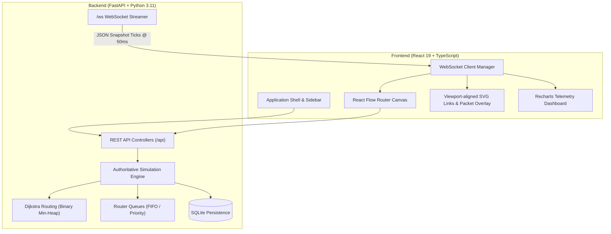
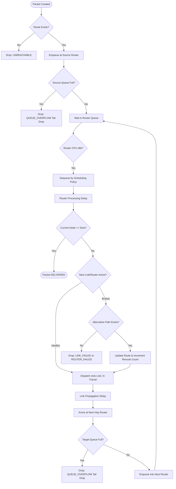
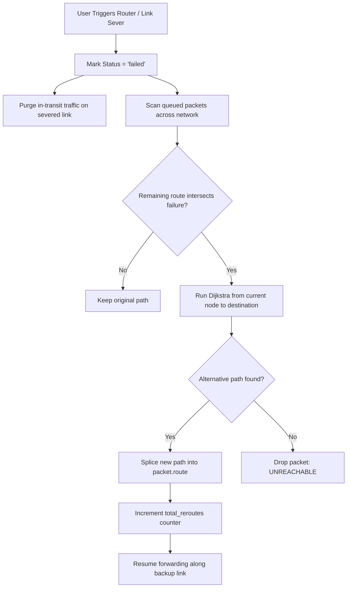

# Real-Time Network Packet Routing Simulator

[](https://fastapi.tiangolo.com)
[](https://react.dev)
[](https://reactflow.dev)
[](https://python.org)
[](LICENSE)

An interactive, real-time computer networks and algorithms simulation platform demonstrating how packets traverse graph topologies, how routers manage traffic using FIFO and Strict Priority queues, how lowest-cost paths are determined via Dijkstra's algorithm with min-heaps, and how networks adapt dynamically to congestion, link failures, and router crashes.

---

## 1. Project Motivation

Understanding modern computer networks and graph algorithms often suffers from static whiteboard diagrams or disconnected toy scripts. Students and evaluators frequently see static routing tables without observing how packets actually wait in router hardware queues, how tail drops occur when buffers fill, or how link failures force mid-transit rerouting.

The **Real-Time Network Packet Routing Simulator** bridges theoretical algorithmic computer science and applied networking engineering by pairing an **authoritative asynchronous simulation engine** with a **reactive observability dashboard**.

---

## 2. Problem Statement

Conventional educational network tools either abstract away algorithmic details (treating shortest-path as an instant calculation) or provide static dashboards that do not model discrete time, queue delays, propagation latency, or failure dynamics. Conversely, enterprise simulators like NS-3 or Cisco Packet Tracer have high barrier-to-entry setup costs and lack modern web-based, real-time interactive visualizers.

This project solves this by delivering an end-to-end, zero-configuration web simulation platform that runs real data structures (binary min-heaps, double-ended queues, adjacency lists) and displays them in real time via WebSockets.

---

## 3. Project Objectives

1. **Authoritative Discrete-Event Simulation Engine**: Model packet generation, queueing, CPU processing, link propagation, delivery, and tail drops in discrete simulation time.
2. **Genuine Algorithmic Implementation**: Execute Dijkstra's shortest-path algorithm using a binary min-heap with time complexity $\mathcal{O}((V + E) \log V)$ and provide step-by-step traces.
3. **Realistic Buffer Management**: Implement physical router queues supporting both FIFO and Strict Priority scheduling with explicit tail-drop overflow policies.
4. **Dynamic Network Adaptability**: Simulate live router failures and severed links, verifying instant dynamic rerouting for in-flight traffic.
5. **Observability & Analytics**: Expose live KPIs (Packet Delivery Ratio, Loss Ratio, Throughput in pps, End-to-End Latency, and Buffer Occupancy) with time-series charts.
6. **Persistence**: Store custom topologies and simulation benchmarks in an embedded SQLite database.

---

## 4. Key Features

- **Interactive Topology Canvas**: Powered by React Flow, featuring custom router nodes displaying live queue occupancy bars, CPU states, and draggable layouts. Network links are drawn in the same pan-and-zoom viewport as the routers.
- **Visual Packet Overlays**: Packets move along their current links according to simulated propagation progress and are color-coded by priority. Enable automatic packet generation and start the simulation to see traffic.
- **Min-Heap Dijkstra Explorer**: Interactive routing tool that details the full algorithmic execution trace with heap states and edge relaxation steps.
- **Queue Deep Dive Monitor**: Inspect per-router buffers, priority breakdowns (Critical, High, Normal, Low), and tail-drop counters.
- **Dynamic Failure & Congestion Injection**: Click to congest or sever any router or link and observe immediate rerouting and latency spikes.
- **Live Recharts Telemetry**: Time-series charts for cumulative delivery vs. drops, instantaneous throughput, and resource utilization.
- **One-Click Demonstration Scenarios**: Preconfigured scenarios for evaluating Shortest Path (Demo A), Congestion (Demo B), Failures (Demo C), and Priority Queuing (Demo D).

---

## 5. Technology Stack

### Backend
- **Language**: Python 3.11+
- **Framework**: FastAPI (REST endpoints + native async WebSockets)
- **ASGI Server**: Uvicorn
- **Data Modeling & Validation**: Pydantic v2
- **Persistence**: SQLite with `aiosqlite`
- **Testing**: Pytest & `pytest-asyncio`

### Frontend
- **Framework**: React 19, TypeScript, Vite
- **Styling**: Tailwind CSS v4 with custom dark telemetry theme
- **Topology Visualization**: React Flow (`@xyflow/react`)
- **Telemetry Charts**: Recharts
- **Icons**: Lucide React
- **Protocol**: Native WebSocket client with auto-reconnection and state reconciliation

---

## 6. System Architecture

The backend owns the authoritative simulation state and clock. The frontend acts as a pure reactive visualization and control layer.



---

## 7. Packet Routing & Lifecycle Flowchart



---

## 8. Dynamic Failure Recovery Flowchart



---

## 9. Data Structures & Algorithmic Roles

| Data Structure | Implementation | Role in System |
| :--- | :--- | :--- |
| **Adjacency List** | `Dict[str, List[Tuple[str, float, str, float]]]` | Graph representation storing neighbors, metric cost, link ID, and latency. |
| **Binary Min-Heap** | Python `heapq` module | Used in Dijkstra's algorithm for $\mathcal{O}(\log V)$ minimum distance node extraction. |
| **Double-Ended Queue** | `collections.deque` | Router FIFO buffer implementing $\mathcal{O}(1)$ enqueue and dequeue operations. |
| **Priority Min-Heap** | Python `heapq` with tuples `(priority, arrival, packet)` | Strict priority router scheduler prioritizing Critical traffic over Normal/Low. |
| **Hash Map / Dict** | Python `dict` | $\mathcal{O}(1)$ lookup for routers, links, active packets, and distances. |
| **Circular Ring Buffer** | Python `list` slicing | Storage for rolling metric snapshots and event log entries. |

---

## 10. Dijkstra's Algorithm & Complexity Analysis

Dijkstra's algorithm finds the shortest path between a source router and all other reachable routers in a weighted graph with non-negative edge costs $w(u, v) \ge 0$.

### Algorithm Summary
1. Initialize distance table: $dist[source] = 0$, and $dist[v] = \infty$ for all $v \ne source$.
2. Insert $(0, source)$ into binary min-heap $Q$.
3. While $Q$ is not empty:
   - Extract minimum $(d, u)$ from $Q$. If $u$ is already settled, skip.
   - Mark $u$ as settled. If $u == destination$, terminate early.
   - For each neighbor $v$ connected via active link $(u, v)$ with cost $w$:
     - If $dist[u] + w < dist[v]$:
       - $dist[v] = dist[u] + w$
       - Record predecessor $prev[v] = u$
       - Insert $(dist[v], v)$ into $Q$.

### Complexity
- **Time Complexity**: $\mathcal{O}((V + E) \log V)$
  - Each router vertex is extracted from the min-heap at most once: $\mathcal{O}(V \log V)$.
  - Each active network link is evaluated once per direction, triggering at most $E$ priority queue pushes: $\mathcal{O}(E \log V)$.
- **Space Complexity**: $\mathcal{O}(V + E)$
  - Adjacency list: $\mathcal{O}(V + E)$
  - Distances and predecessor dictionaries: $\mathcal{O}(V)$
  - Priority queue storage: $\mathcal{O}(V)$.

---

## 11. Performance Metrics

- **Packet Delivery Ratio (PDR)**:
  $$\text{PDR} = \left( \frac{\text{Total Delivered Packets}}{\text{Total Generated Packets}} \right) \times 100$$
- **Packet Loss Ratio (PLR)**:
  $$\text{PLR} = \left( \frac{\text{Total Dropped Packets}}{\text{Total Generated Packets}} \right) \times 100$$
- **Throughput (Packets / Second)**:
  $$\text{Throughput} = \frac{\text{Packets Delivered in Window } \Delta t}{\Delta t}$$
- **Average End-to-End Latency**:
  $$\text{Latency}_{\text{avg}} = \frac{1}{N} \sum_{i=1}^{N} (t_{\text{delivered}, i} - t_{\text{created}, i})$$
- **Buffer Occupancy / Utilization**:
  $$\text{Utilization}_{\text{queue}} = \left( \frac{\text{Current Queue Length}}{\text{Maximum Queue Capacity}} \right) \times 100$$

---

## 12. Project Directory Structure

```
d:/honours/
├── backend/
│   ├── app/
│   │   ├── __init__.py
│   │   ├── main.py                   # FastAPI entrypoint, lifespan, CORS, WebSockets
│   │   ├── config.py                 # Simulation constants and configuration
│   │   ├── api/
│   │   │   ├── __init__.py
│   │   │   ├── routes.py             # REST API controllers
│   │   │   └── websocket.py          # WebSocket client connection manager
│   │   ├── models/
│   │   │   ├── __init__.py
│   │   │   ├── graph.py              # RouterNode, NetworkLink, NetworkTopology
│   │   │   ├── packet.py             # Packet, PacketPriority, PacketStatus, DropReason
│   │   │   └── metrics.py            # SimulationMetrics, EventLogItem, MetricSnapshot
│   │   ├── algorithms/
│   │   │   ├── __init__.py
│   │   │   └── dijkstra.py           # Dijkstra implementation with min-heap & trace
│   │   ├── simulation/
│   │   │   ├── __init__.py
│   │   │   ├── queue.py              # RouterQueue (FIFO, Priority, Tail Drop)
│   │   │   ├── engine.py             # Authoritative async simulation loop
│   │   │   └── topologies.py         # Small, Mesh, and Lab topologies
│   │   └── persistence/
│   │       ├── __init__.py
│   │       └── database.py           # SQLite persistence via aiosqlite
│   ├── tests/
│   │   ├── __init__.py
│   │   ├── test_graph.py             # Graph & adjacency list tests
│   │   ├── test_dijkstra.py          # Shortest-path & trace tests
│   │   ├── test_queues.py            # FIFO, Priority, and Tail Drop tests
│   │   ├── test_simulation.py        # End-to-end packet delivery & reroute tests
│   │   └── test_api.py               # REST API and controls tests
│   ├── requirements.txt
│   ├── pytest.ini
│   └── .env.example
├── frontend/
│   ├── src/
│   │   ├── types/index.ts            # Complete TypeScript domain models
│   │   ├── services/api.ts           # REST API client
│   │   ├── hooks/useSimulation.ts    # WebSocket hook & reactive state sync
│   │   ├── components/
│   │   │   ├── layout/Navbar.tsx     # Top bar with status & simulation clock
│   │   │   ├── layout/Sidebar.tsx    # 8-item navigation sidebar
│   │   │   ├── canvas/NetworkCanvas.tsx # React Flow canvas and viewport-aligned SVG links
│   │   │   ├── canvas/RouterNodeComponent.tsx # Custom router node with queue bar
│   │   │   ├── canvas/PacketOverlay.tsx       # Animated in-transit packets
│   │   │   ├── controls/SimulationControlBar.tsx # Start/stop/step/inject bar
│   │   │   ├── inspector/InspectorPanel.tsx   # Detailed node/link inspector
│   │   │   ├── feed/EventLogFeed.tsx          # Real-time event log feed
│   │   │   └── kpi/KpiCards.tsx               # Real-time KPI summary bar
│   │   ├── pages/
│   │   │   ├── OverviewPage.tsx      # High-level overview & 1-click demo triggers
│   │   │   ├── SimulatorPage.tsx     # Main interactive workspace
│   │   │   ├── TopologyPage.tsx      # Topology manager & parameters table
│   │   │   ├── RoutingPage.tsx       # Dijkstra path finder & min-heap trace table
│   │   │   ├── QueueMonitorPage.tsx  # Deep queue inspection & priority distribution
│   │   │   ├── AnalyticsPage.tsx     # Recharts time-series telemetry
│   │   │   ├── HistoryPage.tsx       # Archived runs from SQLite
│   │   │   └── DocumentationPage.tsx # In-app architectural manual
│   │   ├── App.tsx                   # Root component
│   │   ├── main.tsx                  # Vite React entrypoint
│   │   └── index.css                 # Tailwind v4 theme & custom scrollbars
│   ├── package.json
│   ├── vite.config.ts
│   └── tsconfig.json
├── README.md                         # Project documentation
├── PROJECT_REPORT.md                 # Academic project submission report
└── .gitignore
```

---

## 13. Prerequisites

- **Python**: 3.11 or higher
- **Node.js**: v18.0.0 or higher (v24.x tested)
- **Package Managers**: `pip` and `npm`
- Run the backend and frontend in separate terminals. Keep both terminals open while using the app.

---

## 14. Installation & Setup Instructions

### 1. Clone or Open Workspace
```bash
cd D:\honours
```

### 2. Backend Setup
Run these commands from the project root in PowerShell:
```bash
# Create Python virtual environment
python -m venv backend\venv

# Install dependencies
.\backend\venv\Scripts\python.exe -m pip install -r backend\requirements.txt
```

### 3. Frontend Setup
Open another PowerShell terminal (or return to the project root):
```bash
cd D:\honours\frontend
npm install
```

---

## 15. Execution Instructions

### Start the Backend Server
In the first terminal, from the project root:
```bash
cd D:\honours\backend
.\venv\Scripts\python.exe -m uvicorn app.main:app --host 127.0.0.1 --port 8000 --reload
```
Wait until Uvicorn reports that the application has started. The backend runs at `http://127.0.0.1:8000`; interactive API docs are at `http://127.0.0.1:8000/docs`.

### Start the Frontend Application
In a second terminal:
```bash
cd D:\honours\frontend
npm run dev
```
Open the local URL printed by Vite (normally `http://localhost:5173`). Keep both servers running; the Vite development server proxies `/api` requests and `/ws` WebSocket connections to the backend on port 8000.

### Start a Simulation
1. Open **Simulator** and click **Start**.
2. Leave **Auto Generator** enabled to produce packets automatically. It is enabled by default; adjust the packet rate and source/destination in the control bar as needed.
3. Watch the colored packet markers move along the links. Packet color indicates priority; for example, High-priority packets are amber.
4. Click **Pause** to pause the simulation, **Resume** to continue, or **Reset** to clear the run.

To run a demonstration, open **Overview** and select a demo. The demos configure the topology and simulation for their scenario.

### Troubleshooting
- **Vite reports `ECONNREFUSED 127.0.0.1:8000`**: the backend is stopped or failed to start. Check the backend terminal for an error and start Uvicorn from `D:\honours\backend`.
- **Vite reports WebSocket `ECONNRESET` or `ECONNABORTED`**: the WebSocket connection was interrupted, commonly during a page reload or backend restart. Confirm both servers are running, then reload the page. If the error continues, check that the backend is reachable at `http://127.0.0.1:8000/docs`.
- **The graph is visible but no packets move**: confirm the simulation status is **Running**, **Auto Generator** is checked (or inject a packet manually), and the selected source and destination differ.
- **A paused simulation looks frozen**: that is expected. Click **Resume**; the status and control button should update to reflect the running state.

---

## 16. Automated Testing Instructions

To execute the backend test suite covering graph models, Dijkstra with min-heap, queue policies, end-to-end simulation, and REST endpoints:

```bash
cd D:\honours\backend
.\venv\Scripts\pytest.exe -v
```

---

## 17. Evaluator Demonstration Walkthrough

Follow these steps to demonstrate the simulator to an evaluator or professor:

### Demo A — Shortest-Path Dijkstra Routing
1. Open the web app at `http://localhost:5173`.
2. Click **Overview** or **Routing (Dijkstra)** in the sidebar.
3. Select Source **R1** and Destination **R5**.
4. Click **Run Dijkstra Algorithm**.
5. Observe the computed path `[R1 -> R3 -> R2 -> R4 -> R5]` (Total Metric Cost: 10.0).
6. Inspect the step-by-step min-heap execution trace table showing edge relaxations and heap extractions.
7. Return to the **Simulator** tab, start the simulation, and watch packets move along this exact route.

### Demo B — Congestion & Buffer Overflow (Tail Drops)
1. In the **Simulator** tab, load the **Mesh Network** (or click Demo B on Overview).
2. Set packet generation rate to `4.0 pps` and click **Start**.
   Automatic packet generation is enabled by default; uncheck **Auto Generator** to stop automatic traffic and use manual packet injection only.
3. In the canvas, click router **D** (Hub Center) and click **Inject Congestion**.
4. Observe router D's processing delay increase from 15ms to 45ms.
5. Watch the queue bar fill up to 100% capacity (20/20 packets).
6. Observe subsequent packets dropped due to **Tail Drop (Buffer Overflow)**.
7. Check the KPI cards and Event Feed displaying live `packet.dropped` events with drop reason `QUEUE_OVERFLOW`.

### Demo C — Router Failure & Dynamic Rerouting
1. Load the **Congestion & Failure Lab** topology (8 routers).
2. Set Source **SRC** and Destination **DST**. Notice the primary path is `[SRC -> P1 -> P2 -> P3 -> DST]`.
3. Start the simulation. Packets flow across primary hops.
4. On the canvas, click router **P2** and click **Simulate Router Failure**.
5. Router P2 turns red. Any packets currently queued at P2 are cleanly accounted for.
6. Observe newly arriving packets dynamically rerouting via the northern bypass `B1` (`[SRC -> P1 -> B1 -> P3 -> DST]`) or southern backup `[S1 -> S2]`.
7. Click **Restore Router** on P2. The primary lowest-cost route is restored immediately.

### Demo D — Multi-Priority Queuing
1. Switch router scheduling policy to **Priority**.
2. Inject a **Low** priority packet, followed immediately by a **Critical** priority packet.
3. Switch to the **Queue Monitor** tab.
4. Observe the router priority queue scheduler dequeuing the Critical packet first, demonstrating priority preemption.

---

## 18. Known Limitations & Future Enhancements

- **Link Serialization Delay**: Currently, propagation delay and router CPU processing delay are explicitly simulated; transmission delay based on packet byte size is approximated.
- **TCP Sliding Window & Flow Control**: The current engine implements discrete packet-level delivery and tail drops; implementing full TCP Tahoe/Reno congestion window dynamics ($cwnd$) is a planned future enhancement.
- **Distributed Distance-Vector (Bellman-Ford / BGP)**: While Dijkstra (Link-State) is fully implemented, adding decentralized Bellman-Ford comparisons is planned.

---

## 19. License

This project is released under the [MIT License](LICENSE).
